# 🎓 CampusShop — Marketplace de Emprendimientos Universitarios

<p align="center">
  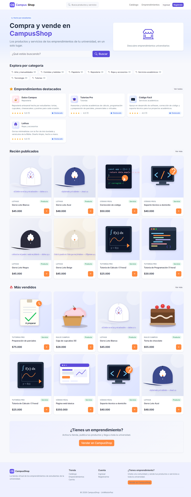
</p>

<p align="center">
  <a href="https://laravel.com"></a>
  <a href="https://php.net"></a>
  <a href="https://getbootstrap.com"></a>
  <a href="https://vitejs.dev"></a>
  <a href="https://www.mysql.com"></a>
  <a href="https://chartjs.org"></a>
  
</p>

---

## 📖 Descripción

**CampusShop** es una plataforma de comercio electrónico diseñada exclusivamente para la comunidad universitaria. Conecta a **estudiantes emprendedores** con la comunidad universitaria, permitiéndoles comercializar sus productos y servicios de forma segura, formalizar sus negocios y medir su crecimiento en tiempo real.

### 🌟 Propuesta de Valor
- **Comunidad cerrada y segura:** Registro verificado exclusivamente con correo institucional (`@unimisionpaz.edu.co`).
- **Canal de comunicación directo:** Chat interno con polling en tiempo real entre comprador y emprendedor para coordinar entregas dentro del campus.
- **Transparencia y reputación:** Sistema de calificaciones y reseñas basado en compras efectivamente entregadas.
- **Analíticas de negocio:** Panel de métricas financieras y de visitas con gráficos interactivos (`Chart.js`) para cada emprendedor.
- **Moderación comunitaria:** Sistema de reportes preventivos para proteger la integridad del catálogo y la comunidad.

---

## 📸 Galería y Vistas del Sistema

### 1. Experiencia Pública y Catálogo
Exploración ágil de productos y servicios con filtros multifacéticos (precio, categoría, tipo de oferta y búsqueda de texto completo).

| Portada Principal | Catálogo Multifiltro |
|:---:|:---:|
| 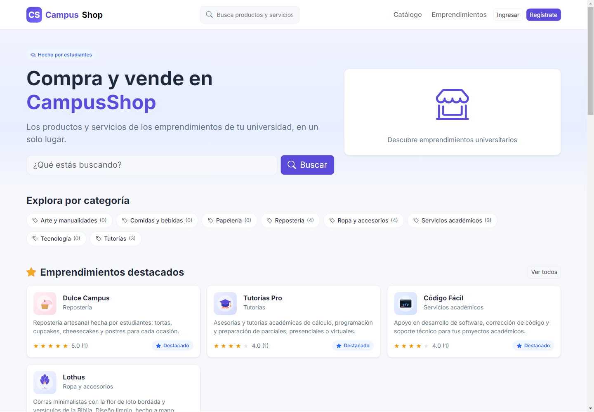 | 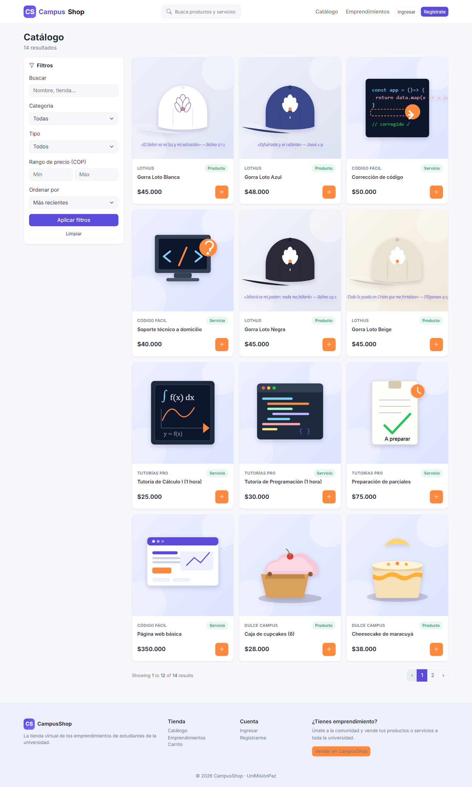 |
| *Hero, productos destacados y accesos directos* | *Filtros reactivos por categoría, tipo y precio* |

---

### 2. Experiencia del Comprador (Estudiante)
Flujo completo de compra: detalle de producto con galería fotográfica real, carrito de compras, checkout con elección de método de pago y seguimiento de pedidos por estados.

| Detalle de Producto & Galería | Carrito & Checkout |
|:---:|:---:|
| 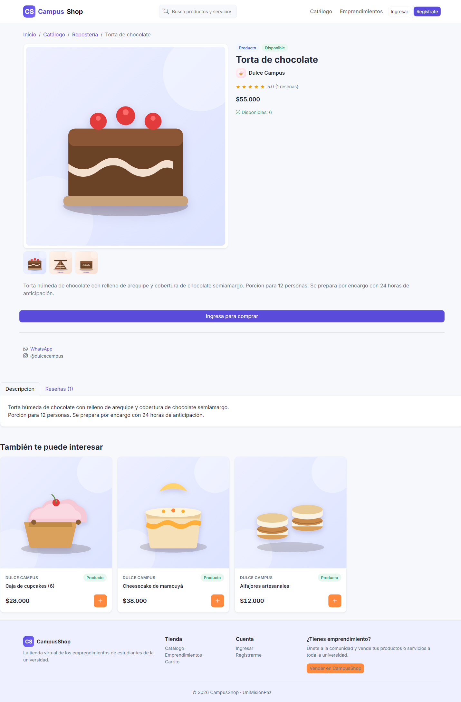 | 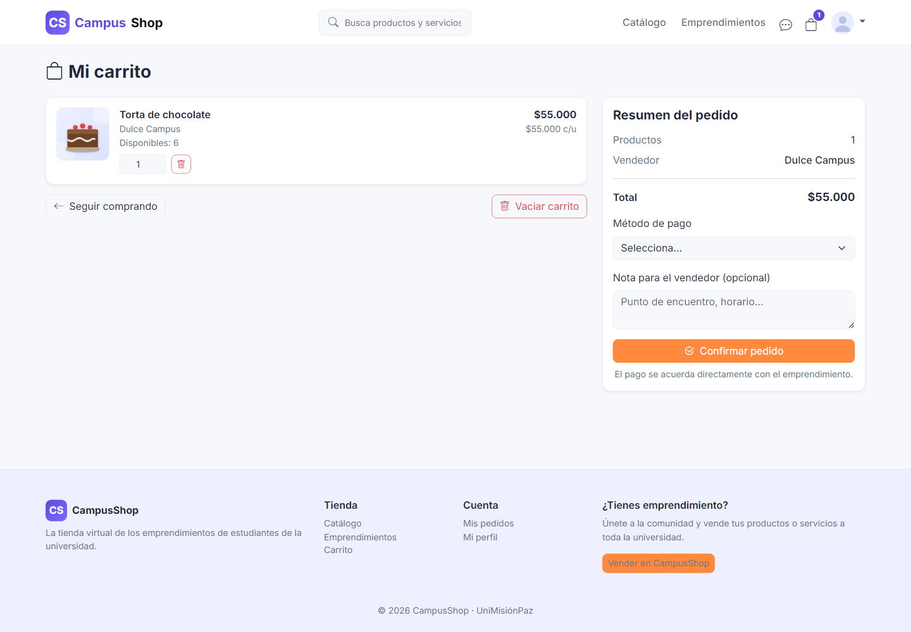 |
| *Galería de fotos reales, stock en tiempo real y reseñas* | *Resumen de orden, notas de entrega y validaciones* |

| Chat Comprador ↔ Emprendedor | Historial de Pedidos y Estados |
|:---:|:---:|
| 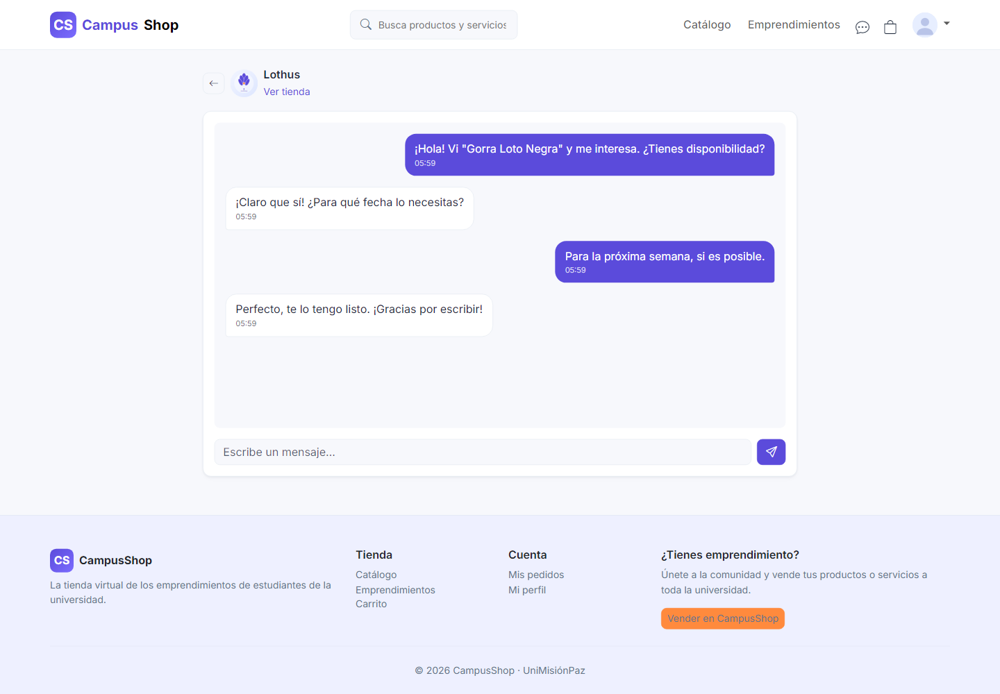 | 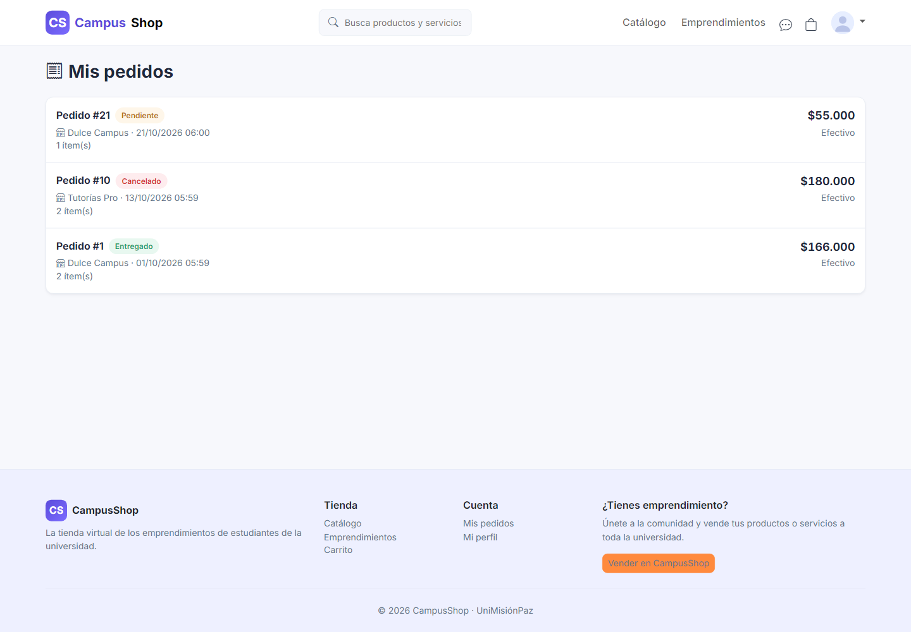 |
| *Mensajería interna para coordinar entregas en campus* | *Estados: Pendiente, Confirmado, Entregado, etc.* |

---

### 3. Panel del Emprendedor («Mi Tienda»)
Centro de mando para que los emprendedores universitarios gestionen sus productos, actualicen estados de pedidos y analicen su rentabilidad.

| Gestión de Tienda e Inventario | Métricas y Analíticas en Tiempo Real |
|:---:|:---:|
| 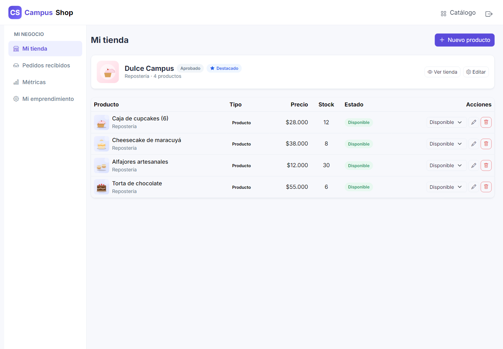 | 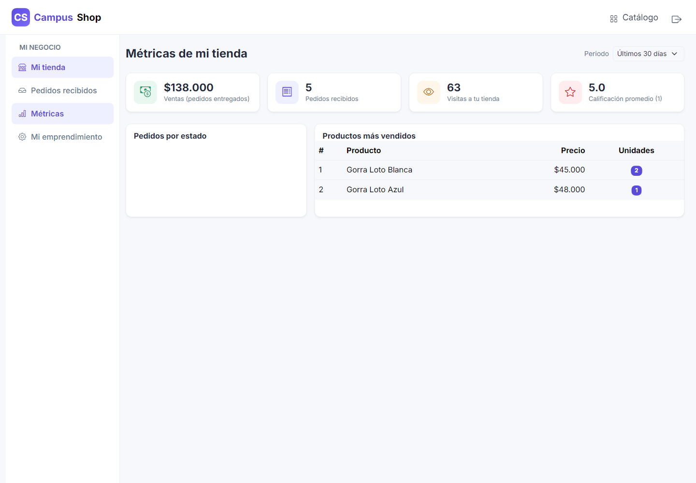 |
| *Control de disponibilidad, precios y catálogo* | *Gráficos de ventas, visitas y ticket promedio* |

---

### 4. Panel de Administración y Moderación
Supervisión general del ecosistema universitario: aprobación de nuevos emprendimientos, gestión de categorías y moderación de contenido reportado.

| Dashboard Administrativo | Moderación y Reportes |
|:---:|:---:|
| 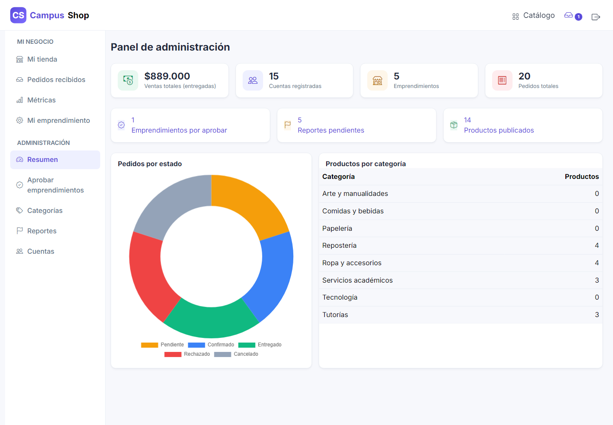 | 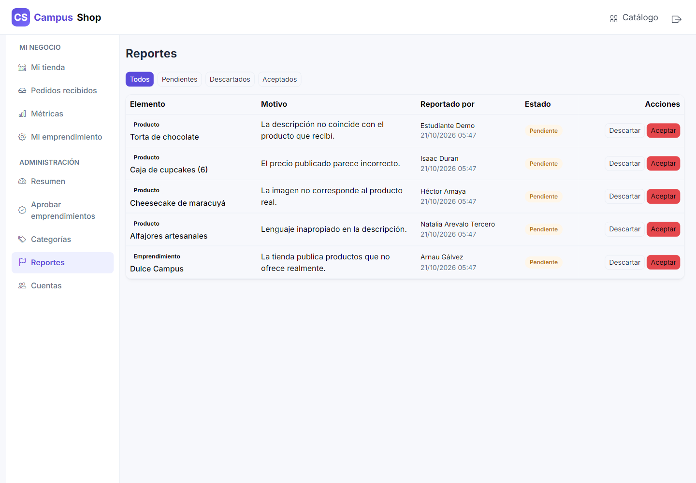 |
| *Métricas globales, balance del sistema y accesos* | *Cola de revisión de contenido y sanciones* |

---

### 5. Experiencia Móvil (Responsive)
Diseño adaptado para teléfonos inteligentes y tablets, optimizado para navegación rápida entre clases.

<p align="center">
  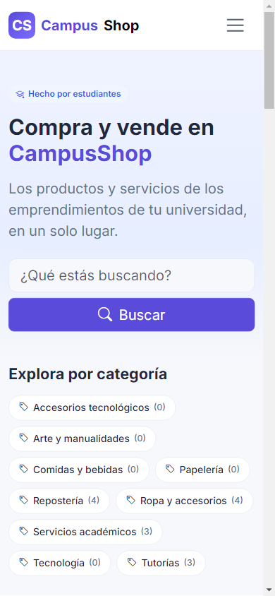
  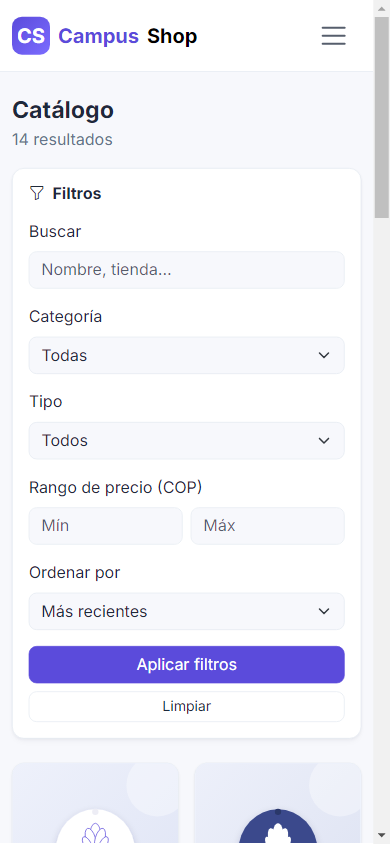
  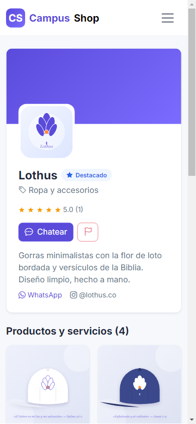
</p>

---

## 🛠️ Stack Tecnológico

| Capa | Tecnologías |
|---|---|
| **Backend** | [Laravel 12](https://laravel.com), PHP 8.2+, Eloquent ORM, Laravel Breeze (Blade Auth) |
| **Frontend** | [Bootstrap 5.3](https://getbootstrap.com), Sass, Vite 5, [Bootstrap Icons](https://icons.getbootstrap.com) |
| **Visualización** | [Chart.js](https://www.chartjs.org) (métricas financieras y tráfico) |
| **Base de Datos** | MySQL 8 (soporte para transacciones con bloqueo pesimista y SoftDeletes) |
| **Almacenamiento** | Helper desacoplado `imagen()` compatible con `public/img` y disco público para hosting compartido |
| **Pruebas** | PHPUnit 11 (30 casos de prueba funcionales + Smoke Tests) |

---

## ⚙️ Reglas de Negocio Destacadas

- **RN-01 (Dominio Institucional):** Solo se admiten correos bajo el dominio de la institución (`@unimisionpaz.edu.co`).
- **RN-02 (Aprobación Previa):** Los emprendimientos requieren aprobación del administrador antes de publicar en el catálogo público.
- **RN-03 (Visibilidad de Productos):** Se distinguen productos disponibles, agotados (visibles sin compra) e inactivos (ocultos).
- **RN-06 (Unicidad por Pedido):** Cada pedido pertenece exclusivamente a un solo emprendimiento; el stock y precios se verifican en el servidor mediante transacciones seguras (`lockForUpdate`).
- **RN-07 (Reseñas Verificadas):** Solo un comprador con pedido en estado `Entregado` puede calificar y reseñar una única vez.
- **RN-10 (Carga de Imágenes):** Formatos permitidos `jpg`, `png`, `webp` de hasta 2 MB, con galerías de hasta 5 fotos por producto.
- **RN-11 (Umbral de Moderación):** Al recibir 3 reportes pendientes, un producto o emprendimiento se oculta preventivamente hasta su revisión por el administrador.

---

## 🚀 Puesta en Marcha (Instalación Local)

### Prerrequisitos
- PHP 8.2 o superior con extensiones estándar (`pdo_mysql`, `mbstring`, `fileinfo`, etc.).
- Composer.
- Node.js 18+ y npm.
- MySQL 8 o MariaDB (incluido en Laragon / XAMPP).

### Paso a paso

```bash
# 1. Clonar el repositorio
git clone https://github.com/HiroXss/CampusShop.git
cd CampusShop

# 2. Instalar dependencias
composer install
npm install

# 3. Configurar entorno
copy .env.example .env
php artisan key:generate

# 4. Configurar base de datos en .env (DB_DATABASE=campushop)
#    y ejecutar migraciones con datos de demostración y fotos reales:
php artisan migrate:fresh --seed

# 5. Generar enlace de almacenamiento
php artisan storage:link

# 6. Compilar assets del frontend
npm run build
# O en modo desarrollo: npm run dev

# 7. Iniciar el servidor local
php artisan serve
```

La aplicación estará lista en: [http://127.0.0.1:8000](http://127.0.0.1:8000).

---

## 🔑 Credenciales de Demostración

Todas las cuentas del seeder utilizan la contraseña **`password`**:

| Rol | Correo Electrónico | Tienda / Propósito |
|---|---|---|
| **Administrador** | `admin@unimisionpaz.edu.co` | Panel administrativo, aprobación y moderación |
| **Estudiante (Comprador)** | `estudiante@unimisionpaz.edu.co` | Compras, carrito, pedidos, chat y reseñas |
| **Emprendedora (Software)** | `sofia@unimisionpaz.edu.co` | **Código Fácil** (Páginas web, soporte técnico) |
| **Emprendedora (Moda)** | `daniela@unimisionpaz.edu.co` | **Lothus** (Gorras minimalistas con bordado) |
| **Comprador Adicional** | `andres@unimisionpaz.edu.co` | Interacción en pedidos, reseñas y chat |
| **Emprendedor (Pendiente)** | `nuevo@unimisionpaz.edu.co` | **Snacks Universitarios** (Cola de aprobación admin) |

---

## 🧪 Pruebas Automatizadas

El proyecto incluye una suite completa de pruebas unitarias y de integración que validan los **30 casos del plan de pruebas (P01–P30)** más pruebas de humo:

```bash
php artisan test
```

| Suite | Casos Cubiertos |
|---|---|
| `AccesoPerfilTest` | P01–P04: Registro, login institucional y perfil |
| `EmprendimientoTest` | P05–P06: Creación y ciclo de vida de tiendas |
| `ProductoTest` | P07–P08: Publicación, stock y reglas de catálogo |
| `CatalogoTest` | P09–P10: Búsqueda y filtros multifacéticos |
| `PedidoTest` | P14–P21: Checkout, flujo de estados y control de concurrencia |
| `ChatTest` | P11–P13: Conversaciones y mensajería en vivo |
| `ResenaTest` | P22–P24: Validación de reseñas verificadas |
| `MetricasTest` | P25–P27: Cálculo de métricas y gráficos |
| `ModeracionTest` | P28–P30: Reportes y umbral de moderación |
| `SmokeTest` | Validación de respuesta HTTP 200 de todas las rutas |

---

## 📁 Estructura del Repositorio

```
CampusShop/
├── app/
│   ├── Http/Controllers/    # Controladores (Público, Comprador, Mi Tienda, Admin)
│   ├── Http/Requests/       # Form Requests con reglas de validación
│   ├── Http/Middleware/     # Control de acceso y roles
│   ├── Models/              # 12 modelos Eloquent con SoftDeletes y relaciones
│   ├── Policies/            # Políticas de autorización por entidad
│   ├── Services/            # Lógica de dominio (PedidoService, MetricasService)
│   └── helpers.php          # Helpers globales: cop(), imagen(), carrito*()
├── config/campushop.php     # Parámetros y constantes de negocio configurables
├── database/
│   ├── migrations/          # Esquema relacional estructurado
│   └── seeders/             # Sembradores de datos y catálogo con fotos reales
├── docs/                    # Especificación SRS, bitácoras y decisiones de diseño
├── public/img/              # Fotografías reales, logos y assets del catálogo
├── resources/
│   ├── views/               # Vistas Blade con componentes modulares
│   └── sass/ & js/          # Estilos y scripts con Vite
└── tests/Feature/           # Suite automatizada de pruebas P01 a P30
```

---

## 📄 Documentación Adicional

- [`docs/SRS.md`](docs/SRS.md): Especificación formal de requerimientos de software (SRS).
- [`docs/PLAN.md`](docs/PLAN.md): Plan de trabajo por fases y trazabilidad.
- [`docs/DECISIONES.md`](docs/DECISIONES.md): Registro de decisiones de arquitectura y diseño.
- [`contenido/capturas/INDICE.md`](contenido/capturas/INDICE.md): Catálogo y descripción de las 76 capturas de pantalla del sistema.
